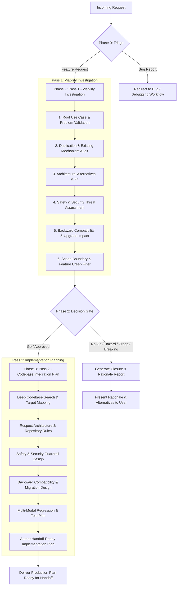

# Feature Request Viability & Implementation Planner

> [!IMPORTANT]
> **Core Mandate: Safety, Security & Strict Backward Compatibility**  
> When evaluating, suggesting, or planning any change, safety, security, and backward compatibility are paramount and non-negotiable. Operating with root privileges, managing filesystem datasets, handling SSH keys, and executing shell commands means that convenience or speed must never compromise data integrity, privilege boundaries, or secure execution.  
> Furthermore, per [RELEASE_CHECKLIST.md](file:///y:/RELEASE_CHECKLIST.md) (Section 3.2), **backward compatibility with older versions of this plugin is a mandatory requirement**: any changes must preserve older sender ↔ newer receiver and newer sender ↔ older receiver interoperability, maintain seamless in-place configuration upgrades without data or setting loss, and provide fallback handling for protocol or command evolutions. If a feature inherently breaks backward compatibility or introduces unmitigated safety/security risks, it must be rejected or fundamentally redesigned.

This skill governs the end-to-end evaluation and planning of new feature requests. It applies a disciplined **two-pass methodology**:

---

## Phase 0: Triage & Request Disambiguation

Before conducting deep analysis, categorize the incoming request:

1.  **Distinguish Feature Requests vs. Bug Reports**:
    *   **Bug Report**: The application already intends to support the capability, but it behaves unexpectedly, errors, crashes, or regressed.  
        *Action*: Do **not** plan this as a new feature. Direct the user to the debugging and defect resolution process.
    *   **Feature Request**: The application functions as built, but a new capability, workflow, configuration toggle, or architectural change is proposed.  
        *Action*: Proceed to Phase 1.
2.  **Clarify Ambiguities**:
    *   If the user's request is vague (e.g., "we need better sync support"), use targeted questions or `ask_question` to identify the specific problem they are trying to solve before proceeding.

---

## Phase 1: First Pass — Viability & Investigation

Execute the core evaluation pillars detailed in [Viability Rubric](./references/viability-rubric.md):

### 1.1 Root Use Case & Problem Discovery (The "Why")
*   Strip away the requested syntax, UI toggle, or implementation idea.
*   Identify the fundamental problem or friction the user faces.
*   Ask: *What exact workflow or user story does this enable, and how frequent is this need?*

### 1.2 Duplication & Existing Mechanism Audit
*   Audit the existing application features, scripts, configuration settings, and CLI tools.
*   Check if there is already an existing way to solve this use case in the app.
*   Enforce the **Single Source of Truth** principle: Do not add duplicate settings or alternate ways of doing the exact same thing, which increases cognitive load and maintenance overhead.
*   If an existing feature partially solves it, evaluate whether a minor improvement to the existing mechanism is cleaner than a brand-new feature.

### 1.3 Architectural & Design Fit (Alternative Solutions)
*   Do not blindly accept the user's suggested implementation mechanism.
*   Analyze if there is a **different solution** to the problem that fits the app's architecture and design patterns significantly better.
    *   *Example*: Extending an existing hook or configuration parameter rather than introducing a whole new subsystem or daemon.
    *   *Example*: Leveraging standard OS/platform utilities rather than bundling custom runtimes.
*   Verify compliance with repository guidelines and constraints (e.g., checking [AGENTS.md](file:///y:/AGENTS.md) for external vendor boundaries and zero-modification rules).

### 1.4 Safety & Security Threat Assessment (Top Priority)
Safety and security are non-negotiable. Before considering any feature desirable, investigate potential security exposures and data safety risks:
*   **Data Integrity & Destructive Risks**: Could this feature lead to accidental data destruction, unintended dataset overwriting, or rogue recursive `zfs destroy` calls?
*   **Command Injection Vectors**: Does the requested mechanism pass user input into shell executions, PHP wrappers, or background daemons?
*   **Privilege & Boundary Discipline**: Does it preserve least privilege? Does it protect private SSH keys (`0600`) and enforce restricted command policies (`restrict_zfs` wrappers)?
*   **Fail-Safe Defaults**: If execution fails midway, does it fail safely without corrupting state or leaving dangling resources?
*   *Rule*: Any feature with unmitigated safety or security hazards is an immediate **No-Go**.

### 1.5 Backward Compatibility & Version Interoperability Audit (Mandatory Requirement)
Per [RELEASE_CHECKLIST.md](file:///y:/RELEASE_CHECKLIST.md) (Section 3.2), backward compatibility across versions is a strict release requirement:
*   **Older Sender → Newer Receiver**: Will an older BuddyBackup installation pushing to a server running this new version still work without allowlist rejection, syntax errors, or handshake failures?
*   **Newer Sender → Older Receiver**: If this feature introduces new remote commands, arguments, or protocol capabilities, does the sender implement fallback mechanisms (such as `send_mark_received_backup` in `rc.buddybackup`) so older receivers that reject newer commands continue functioning seamlessly?
*   **In-Place Configuration Migration**: Does the feature alter configuration schemas (INI, JSON, etc.)? Will existing configuration files written by older versions load cleanly without loss of backup jobs, buddy definitions, SSH keys, or receiver settings? Are safe defaults applied automatically when new keys are missing?
*   **Allowlist & CLI Stability**: Does the change modify `restrict_zfs` commands or CLI flags in a way that breaks existing crons, scripts, or remote peers?
*   *Rule*: Any feature that causes breaking changes for existing users or breaks cross-version peer interoperability without an automated fallback/migration path is a **No-Go** or must be fundamentally redesigned.

### 1.6 Scope Boundary & Feature Creep Filter
*   Determine if this request belongs in the application at all.
*   Ask: *Does this fit the core mission and scope of the app, or is it feature creep?*
*   Evaluate boundaries: Should this be handled by the base operating system, a dedicated complementary tool, or upstream software?
*   Assess the maintenance tax: Will supporting this edge case create disproportionate testing, backward-compatibility, or security burdens?

---

## Phase 2: The Decision Gate (Go vs. No-Go)

Synthesize the findings from Phase 1 into an unambiguous decision:

### Outcome A: NO-GO (Reject / Close Request)
If the request introduces safety/security hazards, breaks backward compatibility without viable fallbacks, is out-of-scope, duplicates existing functionality, violates architectural policies, or imposes excessive maintenance:
1.  **Do NOT produce code or implementation steps.**
2.  Produce a structured **Closure & Rationale Report** based on the [Closure Template](./templates/closure-rationale-template.md).
3.  Clearly explain:
    *   The underlying use case identified.
    *   The specific technical reasons for not implementing it (safety hazard, breaking compatibility, scope creep, duplication, architecture clash).
    *   How the user can accomplish their goal using existing in-app features, workarounds, or external tools.
4.  Deliver this report directly to the user.

### Outcome B: GO (Approve for Implementation)
If the feature addresses a valid need, fits the application's domain, does not duplicate existing tools, is safe and secure, guarantees backward compatibility, and aligns with architecture:
1.  Formulate the refined, architecturally optimal scope (incorporating any superior alternative designs discovered in Phase 1).
2.  Proceed immediately to **Phase 3 (Pass 2)**.

---

## Phase 3: Second Pass — Codebase Integration & Implementation Plan

When approved, create a fully featured implementation plan that is **ready for immediate handoff** to an engineer or implementation agent.

### 3.1 Deep Codebase Inspection
Never guess file paths or internal architectures. Actively inspect the codebase:
1.  Use search tools (`run_command`, `view_file`) to locate relevant code, classes, functions, and configuration files.
2.  Map existing entry points, UI pages, backend scripts, and data flow.
3.  Check repository rules (e.g., [AGENTS.md](file:///y:/AGENTS.md)) to identify any untouchable vendor directories or mandatory wrapper conventions.

### 3.2 Determine Code Placement
Determine where the new code fits naturally into the existing structure:
*   **Backend / Wrappers**: Where does the core logic run? Which existing scripts should be extended?
*   **WebGUI / Presentation**: Which UI files (`.page`, HTML, PHP, JS) need updates to expose the capability cleanly?
*   **Configuration**: Where is state persisted? How are safe defaults provided for backward compatibility?
*   **Lifecycle Hooks / Daemons**: Does this run on a schedule, event trigger, or on-demand?

### 3.3 Account for Edge Cases & Failure Modes
Plan defensive handling for:
*   Missing dependencies or unconfigured states.
*   Invalid user inputs or malformed configurations.
*   Subprocess failures, timeouts, and partial state rollbacks.
*   Smooth upgrades from previous versions (zero breaking changes for existing users).

### 3.4 Backward Compatibility & Upgrade Engineering (Mandatory Requirement)
Explicitly design backward compatibility and migration mechanisms into the implementation plan per [RELEASE_CHECKLIST.md](file:///y:/RELEASE_CHECKLIST.md) (Section 3.2):
*   **Cross-Version Peer Interoperability**:
    *   **Older Sender → Newer Receiver**: Ensure the receiver's `restrict_zfs` allowlist continues accepting legacy command invocations from older BuddyBackup senders.
    *   **Newer Sender → Older Receiver**: If new remote commands or arguments are introduced, architect multi-step fallback logic (e.g., attempt modern parameterized command first; if rejected by older peer's allowlist, gracefully fall back to legacy syntax, similar to `send_mark_received_backup`).
*   **In-Place Configuration Upgrades**:
    *   Ensure all configuration readers apply safe default values for any newly introduced settings when parsing configuration files generated by older plugin versions.
    *   Guarantee zero loss of existing backup jobs, buddy configurations, SSH state, receiver mode, and advanced settings during in-place upgrades.
*   **Protocol & CLI Stability**:
    *   Never remove or rename CLI options, subcommands, or RPC endpoints without maintaining backwards-compatible aliases or fallback paths.

### 3.5 Safety, Security & Guardrail Engineering (Top Priority)
Explicitly architect the safety and security controls into the plan before writing tasks:
*   **Strict Input Validation**: Whitelisting and regex sanitization for dataset names, SSH hosts/ports, paths, and options. Untrusted input must never be interpolated directly into shell strings.
*   **Command Execution Safety**: Safely pass arguments using argument arrays or strict escaping (`escapeshellarg`).
*   **Data Loss Prevention**: Guardrails against destructive operations (e.g., source/destination validation, non-destructive defaults).
*   **Least Privilege & Credential Hygiene**: Maintain restrictive file permissions (`0600` for keys), preserve `restrict_zfs` boundaries, and prevent credential leaks into logs or WebGUI markup.

### 3.6 Mandate Multi-Modal Regression & Bug Prevention Tests
To permanently reduce the chance of introducing new issues or repeating past failures, the plan **must** specify automated tests for any identified bugs, edge cases, regression risks, and backward compatibility. Choose the test modality that best fits the defect:
*   **Perl TAP Tests (`t/*.t`)**: For CLI commands, argument parsing, wrapper logic, system hooks, and cross-version compatibility (executed via `prove -v t/...`). When remote command signatures change, mandate updates to `t/backwards_compat.t` to test both current and legacy allowlists.
*   **Unit / Syntax Tests**: For isolated PHP functions, utility logic, and syntax checks (e.g., `t/php_syntax_and_eval.t`).
*   **Testlab Integration Tests**: For WSL/QEMU multi-node scenarios, ZFS pool setups, replication, daemon operations, and in-place upgrade verification (`testlab/scripts/...`, specifically the `upgrade-preserves-config` scenario).
*   **WebGUI Navigation Tests**: For web UI forms, button clicks, DOM assertions, and error banners using Chrome DevTools MCP (guided by the [testlab-web-navigation](file:///y:/.agent/skills/testlab-web-navigation/SKILL.md) skill).
*   **Custom / Diagnostic Harnesses**: For specialized timing, mock endpoints, or race-condition simulations.

Every bug, regression risk, or backward compatibility requirement identified must be explicitly mapped to a target test file and assertion.

### 3.7 Produce the Handoff-Ready Implementation Plan
Generate the plan using the structure in [Implementation Plan Template](./templates/implementation-plan-template.md):
1.  **Overview & Architectural Rationale**: Why this approach was selected over alternatives.
2.  **File Placement Matrix**: Exact files to create or modify, with specific functions/hooks identified.
3.  **Phased Implementation Tasks**: Modular phases with checkbox tasks, clear acceptance criteria, and isolated validation steps for each phase.
4.  **Backward Compatibility & Migration Strategy**: Explicit interop handling (older/newer sender/receiver), configuration defaults, and upgrade paths.
5.  **Safety, Security & Guardrail Engineering**: Explicit threat controls, validation rules, and data safety mechanisms.
6.  **Automated Verification & Regression Test Plan**: Exact test commands and explicit regression test cases covering all identified bugs, failure modes, and backward compatibility tests (`t/backwards_compat.t`, `upgrade-preserves-config`).
7.  **Maintainer Manual Testing Runbook**: If the feature is manually testable, provide a comprehensive step-by-step walkthrough specifically for the maintainer (target environment, setup, exact UI/CLI actions, expected visual & log outputs, negative tests, and cleanup). If not manually testable, explain why and provide diagnostic command equivalents.
8.  **Risk & Rollback Strategy**: Anticipated regression points and how to revert if needed.

---

## Verification & Handoff Quality Checklist

Before finalizing your response, verify that your output meets these standards:

- [ ] **Objective Viability**: Was the request genuinely scrutinized for feature creep, safety hazards, and duplication, rather than blindly accepted?
- [ ] **Safety & Security First**: Are input validation, command injection safeguards, least privilege, data loss prevention (ZFS safety guards), and fail-safe defaults explicitly engineered?
- [ ] **Backward Compatibility Enforced**: Does the plan ensure zero breaking changes for existing users? Are older sender ↔ newer receiver interoperability, newer sender ↔ older receiver fallbacks, in-place config migration, and `t/backwards_compat.t` / `upgrade-preserves-config` test coverage explicitly engineered per `RELEASE_CHECKLIST.md`?
- [ ] **Architecture First**: If approved, does the plan fit into existing patterns rather than creating an ad-hoc hack?
- [ ] **File Accuracy**: Are all file paths and integration points confirmed against the actual repository?
- [ ] **Policy Compliant**: Does the design strictly adhere to project guidelines (e.g., vendor dependency isolation in `AGENTS.md`)?
- [ ] **Actionable Handoff**: Could a junior engineer or an autonomous agent execute the implementation plan from top to bottom without needing to re-research where code goes?
- [ ] **Maintainer Testing Runbook**: Does the plan include clear, step-by-step manual testing instructions for the maintainer (or an explicit technical justification if manual testing is not applicable)?
- [ ] **Regression & Bug Prevention Tests**: Are automated tests mandated across appropriate test harnesses (`t/*.t`, unit, testlab, or web navigation) for all identified bug, regression, and backward-compatibility risks?

